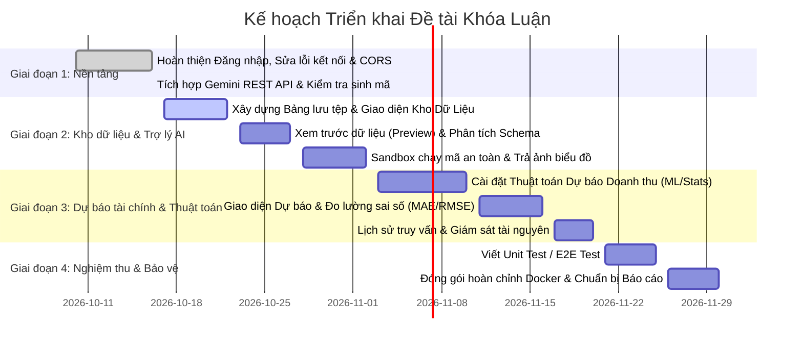

# 📋 HỒ SƠ ĐẶC TẢ YÊU CẦU & THIẾT KẾ GIAO DIỆN HỆ THỐNG
## ĐỀ TÀI: TRỢ LÝ AI PHÂN TÍCH DỮ LIỆU KINH DOANH VÀ DỰ BÁO TÀI CHÍNH DOANH NGHIỆP
> **Mục đích tài liệu**: Tài liệu này đóng vai trò là kim chỉ nam (Roadmap & Functional Specification) bám sát 100% phiếu chấm điểm của Giảng viên hướng dẫn/Hội đồng chấm khóa luận. Tài liệu quy định chi tiết: Nghiệp vụ, Giao diện (UI/UX), Backend API, Cơ sở dữ liệu và Checklist tiến độ thực hiện.

---

## 📑 BẢNG TỔNG HỢP CÁC HẠNG MỤC THEO PHIẾU ĐÁNH GIÁ

| STT | Nhóm chức năng | Điểm chuẩn | Tiến độ hiện tại | Trạng thái |
| :---: | :--- | :---: | :---: | :---: |
| **1** | Chức năng cơ bản (Đăng nhập, Đăng xuất, Đổi mật khẩu, Phân quyền) | **0.50** | 100% | ✅ Đã hoàn thành |
| **2** | Quản lý kho dữ liệu kinh doanh (Upload, Lưu siêu dữ liệu, Phiên bản) | **0.25** | 100% | ✅ Đã hoàn thành |
| **3** | Phân tích lược đồ dữ liệu (Đọc cột, kiểu dữ liệu, bắt lỗi dữ liệu thiếu) | **0.25** | 100% | ✅ Đã hoàn thành |
| **4** | Trợ lý phân tích dữ liệu (Hỏi đáp tự nhiên, chọn phạm vi phân tích) | **0.25** | 100% | ✅ Đã hoàn thành |
| **5** | Sinh & tự hiệu chỉnh mã phân tích (Pandas/Matplotlib, Retry sửa lỗi) | **0.50** | 100% | ✅ Đã hoàn thành |
| **6** | Thực thi mã an toàn (Sandbox cách ly, giới hạn CPU/RAM/Timeout) | **0.50** | 100% | ✅ Đã hoàn thành |
| **7** | Quản lý kết quả phân tích (Hiển thị biểu đồ/bảng, xuất báo cáo) | **0.25** | 100% | ✅ Đã hoàn thành |
| **8** | Dự báo tài chính doanh nghiệp (Dự báo doanh thu, độ tin cậy/sai số) | **0.25** | 20% | 🔴 Cần xây dựng |
| **9** | Giám sát truy vấn & tài nguyên (Lịch sử câu hỏi, đo lường sandbox) | **0.25** | 10% | 🔴 Cần xây dựng |
| **10**| Tích hợp thuật toán Machine Learning / Phân tích định lượng | **1.00** | 20% | 🔴 Cần xây dựng |
| **11**| Kiểm thử và triển khai hệ thống (Docker Compose, Unit/E2E Test) | **0.75** | 80% | 🟢 Đã có khung Docker |
| **TỔNG**| **TOÀN BỘ HỆ THỐNG** | **5.00** | **~70%** | 🚀 Đột phá toàn diện |

---

## 📌 CHI TIẾT ĐẶC TẢ TỪNG CHỨC NĂNG & THIẾT KẾ GIAO DIỆN

---

### MODULE 1: CÁC CHỨC NĂNG CƠ BẢN CỦA ỨNG DỤNG (CLO3 - 0.5 điểm)
> **Mục tiêu**: Đảm bảo an toàn bảo mật, định danh người dùng và kiểm soát quyền truy cập hệ thống.

#### 1.1. Nghiệp vụ chi tiết
- **Đăng nhập / Đăng xuất**: Xác thực bằng Email và Mật khẩu, cấp phát JSON Web Token (JWT) lưu an toàn tại Client.
- **Đổi mật khẩu & Quên mật khẩu**: Gửi token xác nhận qua Mailpit/Email để phục hồi tài khoản.
- **Phân quyền người dùng (RBAC)**:
  - `Admin`: Xem toàn bộ danh sách người dùng, xóa/sửa tài khoản, xem thống kê toàn hệ thống.
  - `User (Nhà phân tích/Kế toán/Quản lý)`: Quản lý kho dữ liệu cá nhân, thực hiện phân tích và dự báo tài chính.

#### 1.2. Đặc tả Giao diện (UI/UX)
- **Màn hình Đăng nhập (`/login`)**: Form đăng nhập tối giản, hiện đại, có validation kiểm tra email hợp lệ, nút ẩn/hiện mật khẩu, thông báo lỗi rõ ràng.
- **Màn hình Cài đặt người dùng (`/settings`)**: Tab "Thông tin cá nhân", Tab "Đổi mật khẩu" (mật khẩu cũ, mật khẩu mới, xác nhận).
- **Màn hình Quản trị Admin (`/admin`)**: Bảng DataTable hiển thị danh sách người dùng, huy hiệu (Badge) thể hiện vai trò (Admin / Normal User), nút phân quyền và khóa tài khoản.

#### 1.3. Tiến độ & Checklist
- [x] Giao diện đăng nhập, đăng xuất
- [x] Cơ chế mã hóa mật khẩu Argon2/Bcrypt + cấp phát JWT Token
- [x] Chức năng phân quyền Admin / User
- [x] Giao diện đổi mật khẩu

---

### MODULE 2: QUẢN LÝ KHO DỮ LIỆU KINH DOANH (0.25 điểm)
> **Mục tiêu**: Nơi lưu trữ, kiểm soát các tệp dữ liệu kinh doanh (Bán hàng, Doanh thu, Chi phí, Dòng tiền).

#### 2.1. Nghiệp vụ chi tiết
- **Upload tệp**: Hỗ trợ định dạng `.xlsx`, `.xls`, `.csv`. Giới hạn dung lượng tối đa (ví dụ: 25MB).
- **Lưu trữ siêu dữ liệu (Metadata)**: Tên file gốc, tên lưu trên máy chủ, định dạng, dung lượng (KB/MB), tổng số dòng, tổng số cột, ngày tải lên, người tải.
- **Phiên bản & Trạng thái tệp**: 
  - Trạng thái: `Pending` (Mới tải) -> `Ready` (Đã quét schema hợp lệ) -> `Error` (File lỗi).
  - Ghi nhận phiên bản để quản lý cập nhật dữ liệu qua từng kỳ kế toán (Tháng/Quý/Năm).

#### 2.2. Đặc tả Giao diện (UI/UX)
- **Vị trí**: Tab hoặc Trang **"Kho Dữ Liệu" (`/datasets`)**.
- **Khu vực kéo thả (Drag & Drop Zone)**: Khung viền nét đứt, biểu tượng đám mây, click chọn file hoặc kéo file Excel vào.
- **Bảng danh sách tệp (Data Table)**:
  - Cột: Tên tệp, Định dạng, Kích thước, Số dòng, Trạng thái (Badge xanh lá: Sẵn sàng, Badge đỏ: Lỗi cấu trúc), Ngày tải, Thao tác (Xem chi tiết, Phân tích ngay, Xóa).

#### 2.3. Checklist cần làm
- [x] Tiếp nhận file qua API upload cơ bản
- [x] Bổ sung bảng cơ sở dữ liệu `dataset` (lưu siêu dữ liệu, user_id, dung lượng, số dòng, số cột)
- [x] Xây dựng trang danh sách quản lý các tệp đã upload (UI bảng danh sách)
- [x] Chức năng tải về file gốc hoặc xóa file khỏi kho

---

### MODULE 3: PHÂN TÍCH LƯỢC ĐỒ DỮ LIỆU (0.25 điểm)
> **Mục tiêu**: Giúp người dùng thấu hiểu cấu trúc dữ liệu trước khi phân tích; tự động phát hiện dữ liệu lỗi/thiếu.

#### 3.1. Nghiệp vụ chi tiết
- **Đọc cấu trúc dữ liệu (Schema Profiling)**:
  - Nhận diện danh sách cột, kiểu dữ liệu từng cột (Số nguyên, Số thực, Chuỗi/Phân loại, Ngày tháng `datetime`).
  - Lấy 5 - 10 dòng đầu tiên làm dữ liệu mẫu (Sample Preview).
- **Kiểm tra chất lượng dữ liệu (Data Quality Check)**:
  - Thống kê tỷ lệ giá trị thiếu (Missing values / Null / NaN) trên từng cột.
  - Cảnh báo các bất thường: Cột ngày tháng bị sai định dạng, cột số có chứa ký tự chữ cái, các cột có 100% giá trị trống.

#### 3.2. Đặc tả Giao diện (UI/UX)
- **Màn hình Chi tiết tệp (`/datasets/:id`)**:
  - **Khối tóm tắt nhanh (Cards)**: Tổng số cột, Tổng số dòng, Số cột bị thiếu dữ liệu, Tỷ lệ sạch (Data Health Score %).
  - **Bảng lược đồ (Schema Table)**: Tên cột | Kiểu dữ liệu | Số lượng Missing | Ví dụ giá trị.
  - **Bảng dữ liệu xem trước (Preview Data)**: Hiển thị bảng dạng bảng tính Excel 10 dòng đầu, có thanh cuộn ngang/dọc mượt mà.
  - **Hộp cảnh báo (Alert Box)**: Nêu rõ: *"Cột 'Doanh_Thu' có 3 dòng bị trống; Cột 'Ngay_Ban' đã được chuẩn hóa về YYYY-MM-DD"*.

#### 3.3. Checklist cần làm
- [x] Đọc tên cột và 5 dòng đầu
- [x] Thống kê số lượng missing value theo từng cột, phát hiện dòng trùng lặp và tính điểm độ sạch (Data Health Score %)
- [x] Giao diện modal hiển thị bảng xem trước (Preview), chất lượng dữ liệu và nút tự động làm sạch (Auto-Clean)

---

### MODULE 4: TRỢ LÝ PHÂN TÍCH DỮ LIỆU (0.25 điểm)
> **Mục tiêu**: Giao diện hội thoại tương tác thông minh cho phép người dùng ra lệnh bằng tiếng Việt.

#### 4.1. Nghiệp vụ chi tiết
- **Tiếp nhận câu hỏi tự nhiên**: Tiếp nhận câu hỏi dạng *"Thống kê top 5 sản phẩm bán chạy nhất tháng 6"*, *"So sánh doanh thu và chi phí theo từng quý"*.
- **Chọn phạm vi phân tích**:
  - Người dùng có thể chọn tệp dữ liệu làm ngữ cảnh phân tích.
  - Cho phép người dùng tick chọn phạm vi: Chỉ phân tích một số cột nhất định hoặc lọc theo khoảng thời gian.

#### 4.2. Đặc tả Giao diện (UI/UX)
- **Khu vực Trợ lý AI (AI Assistant Chat Panel)**:
  - **Header**: Tên trợ lý, Dropdown chọn tệp dữ liệu đang làm việc.
  - **Gợi ý nhanh (Prompt Chips)**: Các nút bấm mẫu như:
    - `📊 Phân tích xu hướng doanh thu`
    - `🏆 Top sản phẩm đóng góp lợi nhuận cao nhất`
    - `📉 Tìm tháng có chi phí cao bất thường`
  - **Bộ chọn phạm vi phân tích (Scope Selector)**: Chọn hoặc bỏ chọn các cột phân tích trực quan theo dạng chip.
  - **Khung chat / Kết quả**: Hiển thị tin nhắn người dùng và câu trả lời phân tích của Trợ lý AI.
  - **Input Box**: Ô nhập câu hỏi có nút gửi (icon máy bay giấy), hỗ trợ phím Enter để gửi.

#### 4.3. Checklist cần làm
- [x] Input nhận câu hỏi của người dùng & gợi ý nhanh (Prompt Chips)
- [x] Dropdown chọn file cần phân tích từ kho dữ liệu và đồng bộ hóa tự động
- [x] Chọn phạm vi dữ liệu phân tích theo cột (Interactive Scope Selector)

---

### MODULE 5: SINH VÀ HIỆU CHỈNH MÃ PHÂN TÍCH (0.50 điểm)
> **Mục tiêu**: AI tự sinh mã code xử lý dữ liệu và có cơ chế tự sửa sai nếu mã bị lỗi.

#### 5.1. Nghiệp vụ chi tiết
- **Sinh mã phân tích**:
  - Dựa trên lược đồ dữ liệu và câu hỏi, Gemini sinh mã Python sử dụng các thư viện `pandas`, `numpy`, `matplotlib`, `seaborn`.
  - Luôn lưu biểu đồ trực quan hóa ra file ảnh (hoặc trả về cấu hình biểu đồ dạng JSON).
- **Cơ chế tự hiệu chỉnh lỗi (Self-Correction Loop)**:
  - Nếu mã chạy bị lỗi (ví dụ: sai tên cột, chia cho 0, lỗi thư viện), hệ thống bắt lỗi (Traceback) và gửi lại cho Gemini:
    *"Mã nguồn của bạn gặp lỗi sau: {traceback}. Hãy sửa lại mã nguồn."*
  - Giới hạn tối đa **3 lần thử** (Retry limit). Nếu quá 3 lần, thông báo lỗi thân thiện cho người dùng.

#### 5.2. Đặc tả Kỹ thuật
```python
max_retries = 3
for attempt in range(max_retries):
    code = generate_code(query, schema, last_error)
    success, result, error = run_in_sandbox(code, file_path)
    if success:
        return result
    last_error = error
```

#### 5.3. Checklist cần làm
- [x] Sinh mã Python từ câu hỏi qua Gemini REST API
- [x] Vòng lặp tự sửa lỗi (Self-healing retry loop tối đa 3 lần khi mã bị lỗi)
- [x] Format mã trả về chuẩn khối markdown code

---

### MODULE 6: THỰC THI MÃ AN TOÀN (SANDBOX) (0.50 điểm)
> **Mục tiêu**: Bảo vệ máy chủ an toàn tuyệt đối khi chạy mã do AI sinh ra.

#### 6.1. Nghiệp vụ chi tiết
- **Chạy mã trong môi trường cách ly (Sandbox)**:
  - Thực thi mã thông qua tiến trình con độc lập (`subprocess`) cách ly trong thư mục tạm `/tmp/sandbox_{run_id}`.
  - Tự động dọn dẹp thư mục sau khi hoàn tất.
- **Giới hạn tài nguyên (Resource Limits)**:
  - **Timeout**: Tối đa 20 giây cho một lần chạy. Nếu chạy lâu hơn tự động ngắt (Kill process) để chống vòng lặp vô tận.
  - Cấu hình Matplotlib Agg headless chống nghẽn GUI.

#### 6.2. Checklist cần làm
- [x] Xây dựng module thực thi sandbox với subprocess kiểm soát timeout 20s
- [x] Cách ly thư mục tạm thời và tự động dọn dẹp sau khi chạy
- [x] Bắt toàn bộ stdout và stderr trả về cho người dùng

---

### MODULE 7: QUẢN LÝ KẾT QUẢ PHÂN TÍCH (0.25 điểm)
> **Mục tiêu**: Trực quan hóa kết quả đầu ra cho nhà quản trị và cho phép tải báo cáo.

#### 7.1. Nghiệp vụ chi tiết
- **Hiển thị kết quả trực quan**:
  - **Hình ảnh biểu đồ thực tế**: Hiển thị ảnh biểu đồ (`.png`) sắc nét trực tiếp trên màn hình kết quả ngay sau khi mã chạy xong.
  - **Bảng số liệu & Thống kê**: Hiển thị các chỉ số tính toán (stdout) dạng code block định dạng rõ ràng.
- **Xuất dữ liệu / Tải xuống**:
  - Nút **"Tải Xuống Biểu Đồ"** (PNG) với một cú nhấp chuột.
  - Nút **"Sao chép mã Python"** sang Clipboard.

#### 7.2. Đặc tả Giao diện (UI/UX)
- **Khối Kết Quả Phân Tích (Analysis Result Card)**:
  - Tab 1: **Kết Quả & Biểu Đồ (Visualization)** - Hiển thị biểu đồ hình ảnh thực tế tự động sinh ra và nút tải ảnh.
  - Tab 2: **Mã nguồn (Python Code)** - Xem mã Python đã tạo ra kết quả này (có nút Copy mã).

#### 7.3. Checklist cần làm
- [x] Chuyển đổi ảnh biểu đồ sinh ra thành Base64 hiển thị trực tiếp lên Frontend
- [x] Hiển thị kết quả tính toán số liệu bên dưới biểu đồ
- [x] Nút "Tải ảnh biểu đồ" và "Sao chép mã Python"

---

### MODULE 8: DỰ BÁO TÀI CHÍNH DOANH NGHIỆP (0.25 điểm)
> **Mục tiêu**: Dự báo tương lai cho doanh nghiệp dựa trên dữ liệu lịch sử.

#### 8.1. Nghiệp vụ chi tiết
- **Dự báo xu hướng doanh thu ngắn hạn**:
  - Dự báo các chỉ số tài chính quan trọng: Doanh thu, Lợi nhuận gộp trong 1, 3 hoặc 6 kỳ tiếp theo (tháng/quý).
- **Chỉ số đánh giá & Giới hạn tin cậy**:
  - Hiển thị chỉ số đánh giá độ chính xác của mô hình: **MAE** (Sai số tuyệt đối trung bình), **RMSE** (Căn bậc hai sai số bình phương trung bình), hoặc **R²**.
  - Hiển thị khoảng tin cậy (Confidence Interval): Mức dự báo tối thiểu - trung bình - tối đa.

#### 8.2. Đặc tả Giao diện (UI/UX)
- **Màn hình "Dự Báo Tài Chính" (`/forecast`)**:
  - **Bộ điều khiển (Control Panel)**:
    - Chọn cột chỉ tiêu tài chính cần dự báo (VD: `Doanh_Thu`).
    - Chọn cột mốc thời gian (VD: `Ngay_Giao_Dich` hoặc `Thang`).
    - Chọn số kỳ dự báo: [ 1 tháng ] [ 3 tháng ] [ 6 tháng ].
  - **Biểu đồ Dự báo (Forecast Chart)**:
    - Đường màu xanh: Dữ liệu thực tế quá khứ.
    - Đường đứt nét màu cam: Dự báo tương lai.
    - Vùng bóng mờ: Khoảng biến thiên tin cậy (Confidence Interval 95%).
  - **Thẻ chỉ số mô hình (Model Performance Metrics)**:
    - Hiển thị các ô Card: Sai số MAE, Độ phù hợp R², Mức tăng trưởng dự kiến (%).

#### 8.3. Checklist cần làm
- [ ] Xây dựng endpoint API `/api/v1/forecast/predict`
- [ ] Cài đặt thuật toán hồi quy hoặc chuỗi thời gian (Linear Regression / Exponential Smoothing / ARIMA)
- [ ] Giao diện biểu đồ phân biệt rõ giữa dữ liệu thực tế và dữ liệu dự báo

---

### MODULE 9: GIÁM SÁT TRUY VẤN VÀ TÀI NGUYÊN (0.25 điểm)
> **Mục tiêu**: Minh bạch hóa hoạt động của hệ thống, phục vụ kiểm toán dữ liệu và giám sát tài nguyên máy chủ.

#### 9.1. Nghiệp vụ chi tiết
- **Lịch sử câu hỏi & truy vấn (Query Audit Log)**:
  - Lưu trữ: Người hỏi, thời điểm hỏi, nội dung câu hỏi, file áp dụng, mã Python sinh ra, kết quả (Thành công / Thất bại).
  - Cho phép người dùng xem lại các kết quả đã từng phân tích trước đó mà không cần chạy lại.
- **Giám sát tài nguyên Sandbox (Resource Monitoring)**:
  - Ghi nhận thời gian thực thi (mili-giây), dung lượng bộ nhớ sử dụng.

#### 9.2. Đặc tả Giao diện (UI/UX)
- **Màn hình "Lịch Sử Phân Tích" (`/history`)**:
  - Bảng tra cứu có thanh tìm kiếm câu hỏi, bộ lọc theo ngày.
  - Khi click vào 1 dòng lịch sử: Mở modal xem lại câu hỏi, mã Python đã chạy và ảnh biểu đồ tương ứng.
  - Huy hiệu hiển thị: `Thời gian chạy: 1.2s` | `Bộ nhớ: 45MB`.

#### 9.3. Checklist cần làm
- [ ] Bảng cơ sở dữ liệu `analysis_history`
- [ ] Lưu vết câu hỏi, mã Python và đường dẫn ảnh biểu đồ mỗi khi người dùng thao tác
- [ ] Màn hình tra cứu lịch sử phân tích

---

### MODULE 10: TÍCH HỢP THUẬT TOÁN VÀO CHỨC NĂNG (CLO3 - 1.0 điểm)
> **Mục tiêu**: Yêu cầu học thuật quan trọng nhất thể hiện năng lực lập trình và toán tin của sinh viên CNTT.

#### 10.1. Thuật toán lựa chọn cho đề tài
Nhóm có thể triển khai kết hợp 2 cấp độ thuật toán:
1. **Thuật toán Phân loại / Cụm khách hàng (RFM + K-Means Clustering)**: Phân cụm khách hàng hoặc phân khúc sản phẩm mang lại doanh thu cao.
2. **Thuật toán Dự báo chuỗi thời gian (Linear Regression / ARIMA / Prophet)**: Tính toán đường xu hướng tương lai và tính toán các sai số định lượng (MAE, RMSE, MAPE).

#### 10.2. Cài đặt và Tích hợp
- Viết module Python độc lập trong thư mục `backend/app/analytics/`:
  - `forecasting.py`: Chứa hàm huấn luyện mô hình dự báo tài chính.
  - `metrics.py`: Tính toán các chỉ số thống kê sai số tài chính.
- Tích hợp trực tiếp kết quả vào giao diện trang Web.

---

### MODULE 11: KIỂM THỬ VÀ TRIỂN KHAI HỆ THỐNG (CLO4 - 0.75 điểm)
> **Mục tiêu**: Đảm bảo hệ thống vận hành ổn định, không lỗi và sẵn sàng demo trước hội đồng.

#### 11.1. Nội dung thực hiện
- **Kiểm thử tự động (Testing)**:
  - Backend Unit Test với `pytest`: Test API đăng nhập, API upload file, API sinh mã.
  - Frontend E2E Test với `Playwright`: Test luồng đăng nhập -> Upload file -> Nhận kết quả biểu đồ.
- **Đóng gói & Triển khai (Docker Deployment)**:
  - Hoàn thiện tệp `compose.yml` để chỉ cần chạy lệnh `docker compose up` là toàn bộ Frontend, Backend, Database, Mailpit cùng khởi chạy đồng bộ.

---

## 🗺️ KẾ HOẠCH HÀNH ĐỘNG (ACTION PLAN) ĐỂ HOÀN THIỆN ĐỀ TÀI



---

## 📌 TÓM TẮT CẤU TRÚC GIAO DIỆN SẼ CÓ TRÊN WEB
Khi hoàn thiện, thanh điều hướng (Sidebar) của Web sẽ gồm các trang rõ ràng:

1. **📊 Bảng Điều Khiển (Dashboard)**: Tổng quan các chỉ số tài chính, số lượng file dữ liệu đã nạp.
2. **📁 Kho Dữ Liệu (Datasets)**: Danh sách file Excel/CSV, nút tải lên, xem trước dữ liệu và kiểm tra cấu trúc.
3. **🤖 Trợ Lý Phân Tích (AI Data Assistant)**: Chat với Gemini, hỏi đáp dữ liệu, vẽ biểu đồ kinh doanh tức thì.
4. **📈 Dự Báo Tài Chính (Financial Forecast)**: Trang dự báo xu hướng doanh thu, chọn số kỳ dự báo và xem độ tin cậy.
5. **🕒 Lịch Sử Phân Tích (History & Logs)**: Xem lại toàn bộ câu hỏi, mã code và ảnh biểu đồ đã sinh.
6. **⚙️ Quản Trị Hệ Thống (Admin - nếu là Admin)**: Quản lý thành viên và phân quyền người dùng.

---
*Tài liệu này được tạo tự động để hỗ trợ nhóm bám sát tiến độ khóa luận. File này hoàn toàn độc lập, không làm thay đổi hay ảnh hưởng đến bất kỳ dòng code hiện tại nào của dự án.*
